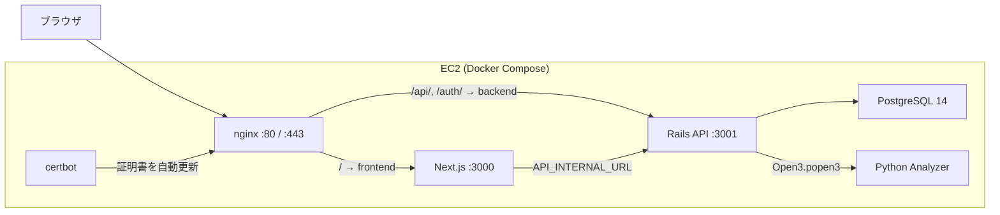

# Music Portfolio AI

**音楽家と制作依頼者を AI でつなぐマッチングプラットフォーム**

[](https://github.com/syo030078/music-portfolio-ai/actions/workflows/test.yml)
[](https://github.com/syo030078/music-portfolio-ai/actions/workflows/deploy.yml)

**デモ**: https://musicportfolioai.com/

---

## 主要機能

| 機能 | 概要 |
|------|------|
| 🎵 楽曲の AI 解析 | アップロードした楽曲の BPM・キー・ジャンルを librosa で自動推定 |
| 🤖 楽曲説明文の生成 | 解析結果から楽曲の特徴・雰囲気・用途を GPT-4o-mini で生成 |
| 🔍 AI マッチング | 自然言語の要望から、合う楽曲をスコア付きで最大 5 件推薦 |
| 📋 ポートフォリオ | 解析データをもとに音楽家プロフィールを構築 |
| 📝 案件管理 | 案件の投稿 → 提案 → 契約をステータスで管理 |
| 👥 ロール別 UI | ミュージシャン / クライアントで画面と操作を切り替え |
| 💬 メッセージ | 依頼者と音楽家のメッセージのやり取り（REST） |
| 🔐 認証 | JWT 認証。ログアウト時はトークンを無効化 |

---

## 技術スタック

| レイヤー | 技術 | 選定理由 |
|----------|------|----------|
| Frontend | Next.js 15 (App Router), React 19, TypeScript strict, Tailwind CSS 4 | Server Components でデータ取得をサーバー側に寄せられる |
| Backend | Rails 7 API mode, Ruby 3.1 | ActiveRecord のモデル層とマイグレーション管理 |
| Database | PostgreSQL 14 | UUID・CHECK 制約で整合性を DB 層でも保証できる |
| 音響解析 | Python, librosa | Ruby に同等のライブラリがないため、Python を別プロセスで実行 |
| LLM | OpenAI GPT-4o-mini | 説明文生成とマッチングに十分な品質で、コストが低い |
| 認証 | Devise + devise-jwt | SPA と API の間をステートレスに認証できる |
| バリデーション | Zod | API レスポンスとフォーム入力を実行時にも検証する |
| Infra | Docker Compose, nginx, Let's Encrypt, EC2, GitHub Actions | 開発と本番を同じ構成で動かす |

---

## アーキテクチャ



- **楽曲アップロードの流れ**: Next.js → `POST /api/v1/tracks` → Rails が Python Analyzer を別プロセスで起動（60 秒でタイムアウト）→ BPM・キー・ジャンルを保存。説明文は後から `generate_ai_text` を呼んだときに、保存済みの解析結果をもとに OpenAI で生成する
- **CI/CD**: PR と push で RSpec / ESLint / `tsc --noEmit` を並列に実行。main で成功すると EC2 に SSH してビルド → マイグレーション → 起動し、最後に `https://musicportfolioai.com/api/v1/health` を確認する

---

## API

内部の連番 `id` は URL に出さず、`uuid` でリソースを指定します。全ルートは [`backend/config/routes.rb`](backend/config/routes.rb) にあります。

| リソース | エンドポイント | 主な操作 |
|----------|---------------|----------|
| 認証 | `/auth/sign_up`, `/auth/sign_in`, `/auth/sign_out` | 登録 / ログイン / ログアウト |
| ユーザー | `/api/v1/user`, `/api/v1/users/:uuid` | 自分のプロフィールの取得・更新 / 公開プロフィール |
| 楽曲 | `/api/v1/tracks`, `/api/v1/tracks/:id/generate_ai_text` | 一覧・アップロード（解析を自動実行）/ 説明文の生成 |
| マッチング | `/api/v1/matching` | 自然言語から楽曲を推薦 |
| 案件・提案 | `/api/v1/jobs`, `/api/v1/jobs/:uuid/proposals`, `/api/v1/proposals/:uuid/accept\|reject` | 投稿 / 提案 / 承認すると契約を自動作成 |
| 制作依頼 | `/api/v1/production_requests/:uuid/accept\|reject\|withdraw` | 音楽家への直接依頼 |
| メッセージ | `/api/v1/conversations`, `/api/v1/conversations/:id/messages` | 会話 / 送信 |
| ヘルスチェック | `/api/v1/health` | 稼働確認 |

エラーレスポンスの形は統一しています：`{ error: "..." }`（単一のエラー）/ `{ errors: [...] }`（バリデーションエラー）。

---

## データベース

20 テーブル。全カラムと制約は [`docs/architecture/er-diagram.puml`](docs/architecture/er-diagram.puml) を参照してください。

- `conversations` は `job_id` と `contract_id` の XOR 制約で「契約前の会話」と「契約後の会話」を分けている
- `contracts` は `proposal_id` と `production_request_id` の XOR 制約で、契約の作られ方を 1 つに限定している

---

## 設計判断

**Rails API + Next.js に分けた理由**
検索 → 試聴 → 提案 → 契約という操作の多い UI は SPA で作りたかった。一方で、データモデルとマイグレーションは Rails の ActiveRecord に任せたかった。代わりに CORS とトークン管理の手間が増える。

**UUID を公開キーにした理由**
連番 ID を URL に出すと、他人のリソースを推測できてしまう（IDOR）。外向けには UUID、内部の JOIN には連番 ID を使い分けている。

**Python をサブプロセスで動かす理由**
解析は 1 リクエストにつき 1 回だけなので、別の API サーバーとして運用するほどの頻度ではない。そこで `Open3.popen3` と 60 秒のタイムアウト（超えたら `Process.kill`）だけで済ませている。

**4 層でバリデーションする理由**
`TypeScript → Zod → ActiveRecord → PostgreSQL CHECK 制約` の 4 層です。チェックは重複するが、API を直接叩かれても不正なデータが DB に入らない。

---

## その他の実装ポイント

- ログアウト時は JWT を `JwtDenylist` に登録し、サーバー側でも無効にする
- 本番は HTTPS で配信している（Let's Encrypt）。HTTP → HTTPS へのリダイレクトと HSTS を設定済み
- 本番の Docker イメージはマルチステージビルドで作り、root 以外のユーザーで実行する
- 解析に失敗してもデフォルト値（BPM=120, Key=C, Genre=Pop）を入れて登録を続ける
- OpenAI の API キーがない場合や LLM がエラーを返した場合も、AI 機能以外は普通に動く

---

## 開発環境セットアップ

```bash
git clone https://github.com/syo030078/music-portfolio-ai.git
cd music-portfolio-ai
cp .env.example .env
docker compose up
```

| サービス | URL |
|----------|-----|
| Frontend | http://localhost:3001 |
| Backend API | http://localhost:3000 |

<details>
<summary>個別セットアップ（Docker を使わない場合）</summary>

#### Backend

```bash
cd backend
bundle install
bin/rails db:setup    # DB作成 + マイグレーション + シードデータ
bin/rails server      # http://localhost:3000
```

#### Frontend

```bash
cd frontend
npm install
npm run dev           # http://localhost:3001
```

環境変数（`frontend/.env.local`）:

```
NEXT_PUBLIC_API_URL=http://localhost:3000
```

#### Analyzer

前提: ffmpeg が必要（macOS: `brew install ffmpeg` / Ubuntu: `sudo apt install ffmpeg`）

```bash
cd analyzer
python -m venv .venv
source .venv/bin/activate
pip install -r requirements.txt
python music_analyzer.py --file path/to/audio.mp3
```

</details>

---

## テスト

```bash
# Backend（RSpec: 35 specファイル）
cd backend && bundle exec rspec

# Frontend（ESLint + TypeScript型検査）
cd frontend && npm run lint && npx tsc --noEmit

# Analyzer
cd analyzer && python test_music_analyzer.py
```

---

## リポジトリ構成

```
frontend/         Next.js 15 (App Router)
backend/          Rails 7 API
analyzer/         Python 音響解析 (librosa)
infrastructure/   EC2 構築・デプロイ用スクリプト、nginx 設定
docs/             設計資料（ER 図など）
.github/workflows CI (test.yml) / CD (deploy.yml)
```

---

## 今後の開発予定

- RAG（pgvector + Embedding によるベクトル検索）
- 楽曲の波形表示・プレビュー再生
- リアルタイム通知（WebSocket / Action Cable）
- 楽曲検索のフィルタ強化（BPM の範囲・ジャンル）

---

## ライセンス

MIT
