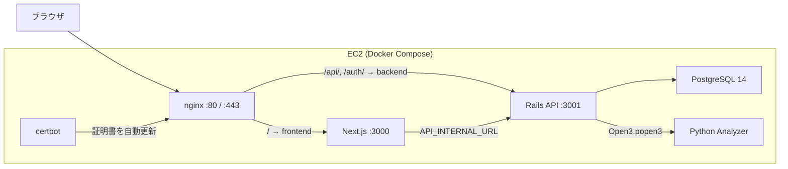

# Music Portfolio AI

音楽家と制作依頼者をつなぐマッチングプラットフォーム。音楽家がアップロードした楽曲を AI が解析し、依頼者はその解析結果をもとに音楽家を探して制作を依頼する。

[](https://github.com/syo030078/music-portfolio-ai/actions/workflows/test.yml)
[](https://github.com/syo030078/music-portfolio-ai/actions/workflows/deploy.yml)

**デモ**: https://musicportfolioai.com/

---

## 背景

音楽制作の依頼では、依頼者と音楽家の双方に次の課題がある。

- **依頼者**: 音楽家の作風（テンポ・調・ジャンル）が自分の要望に合うかどうかは、曲を 1 つずつ聴かないと判断できない
- **音楽家**: 作品を並べるだけでは得意分野が伝わらず、依頼につながりにくい

このサービスでは、楽曲を AI で解析して作風を数値と文章で示す。依頼者は要望を文章で入力するだけで、合う楽曲と音楽家を見つけられる。

---

## 主要機能

上の 2 つの課題に対応する機能と、依頼から契約・連絡までを行う機能に分かれる。

| 利用者 | 機能 | 内容 |
|--------|------|------|
| 音楽家 | 楽曲解析 | アップロードした楽曲の BPM・キー・ジャンルを librosa で推定する |
| 音楽家 | 説明文生成 | 解析結果をもとに、楽曲の特徴・雰囲気・用途を GPT-4o-mini で文章にする |
| 音楽家 | ポートフォリオ | プロフィールと楽曲（解析結果・説明文）を音楽家ごとのページで公開する |
| 依頼者 | AI マッチング | 自然言語の要望に合う楽曲を、スコア付きで最大 5 件推薦する |
| 依頼者 | 案件・直接依頼 | 案件を公開して提案を募るか、音楽家に直接依頼する。承認すると契約になる |
| 共通 | メッセージ | 依頼者と音楽家が案件・契約ごとにやり取りする |
| 共通 | 認証 | JWT で認証し、音楽家と依頼者で使える画面と操作を分ける |

---

## 技術スタック

Web アプリ本体は Rails と Next.js で作り、音響解析だけを Python で行う。

| レイヤー | 技術 | 選定理由 |
|----------|------|----------|
| Frontend | Next.js 15 (App Router), React 19, TypeScript strict, Tailwind CSS 4 | Server Components でデータ取得をサーバー側で行える |
| Backend | Rails 7 API mode, Ruby 3.1 | ActiveRecord でモデルの関連・検証・マイグレーションをまとめて管理できる |
| Database | PostgreSQL 14 | UUID と CHECK 制約で、整合性を DB 層でも保証できる |
| 音響解析 | Python, librosa | Ruby には同等の音響解析ライブラリがない |
| LLM | OpenAI GPT-4o-mini | 用途に足りる品質で、コストが低い |
| 認証 | Devise + devise-jwt | SPA と API の間をステートレスに認証できる |
| バリデーション | Zod | TypeScript の型では検査できない実行時の値を検証できる |
| Infra | Docker Compose, nginx, Let's Encrypt, EC2, GitHub Actions | 開発と本番を同じ構成で動かせる |

---

## アーキテクチャ

nginx がリクエストをパスで振り分け、`/api/` と `/auth/` を Rails、それ以外を Next.js に渡す。



以下の 2 つの処理は、上の図のどこを通るかを追うと全体の動きがわかる。

**楽曲アップロードの処理**

1. Next.js が `POST /api/v1/tracks` に音声ファイルを送る
2. Rails が Python Analyzer を別プロセスで起動する（60 秒でタイムアウト）
3. 推定した BPM・キー・ジャンルを保存する

説明文の生成はアップロードとは別の処理で、`POST /api/v1/tracks/:id/generate_ai_text` を呼んだときに行う。

**CI/CD**

1. PR と push のたびに、RSpec・ESLint・`tsc --noEmit` を並列で実行する
2. main で成功すると、EC2 に SSH してビルド → マイグレーション → 起動を行う
3. 最後に `https://musicportfolioai.com/api/v1/health` を確認し、失敗したらデプロイを失敗として扱う

---

## API

URL では内部の連番 `id` を使わず、`uuid` でリソースを指定する。全ルートは [`backend/config/routes.rb`](backend/config/routes.rb) にある。

| リソース | エンドポイント | 主な操作 |
|----------|---------------|----------|
| 認証 | `/auth/sign_up`, `/auth/sign_in`, `/auth/sign_out` | 登録 / ログイン / ログアウト |
| ユーザー | `/api/v1/user`, `/api/v1/users/:uuid` | 自分のプロフィールの取得・更新 / 公開プロフィール |
| 楽曲 | `/api/v1/tracks`, `/api/v1/tracks/:id/generate_ai_text` | 一覧・アップロード / 説明文の生成 |
| マッチング | `/api/v1/matching` | 自然言語から楽曲を推薦 |
| 案件・提案 | `/api/v1/jobs`, `/api/v1/jobs/:uuid/proposals`, `/api/v1/proposals/:uuid/accept\|reject` | 案件の投稿 / 提案 / 承認（契約を作成） |
| 直接依頼 | `/api/v1/production_requests/:uuid/accept\|reject\|withdraw` | 依頼の作成 / 承認（契約を作成）/ 却下 / 取り下げ |
| メッセージ | `/api/v1/conversations`, `/api/v1/conversations/:id/messages` | 会話の作成 / メッセージの送信 |
| ヘルスチェック | `/api/v1/health` | 稼働確認 |

エラーレスポンスの形式は 2 種類に統一している。

- 単一のエラー: `{ error: "..." }`
- バリデーションエラー: `{ errors: ["...", ...] }`

---

## データベース

全 20 テーブル。カラムと制約の一覧は [`docs/architecture/er-diagram.puml`](docs/architecture/er-diagram.puml) にある。

契約と会話は、それぞれ 2 つの外部キーのうち必ず片方だけが入るように CHECK 制約で強制している。

| テーブル | 外部キー | 意味 |
|----------|----------|------|
| `contracts` | `proposal_id` / `production_request_id` | 契約の元は、案件への提案か直接依頼のどちらか一方 |
| `conversations` | `job_id` / `contract_id` | 会話は、契約前（案件）か契約後（契約）のどちらか一方 |

---

## 設計判断

各判断を「課題 → 選択 → 代償」の順に書く。

### Rails API と Next.js を分ける

- **課題**: 検索・試聴・提案・契約と画面操作が多く、SPA で作りたい。一方、モデルとマイグレーションの管理は Rails に任せたい
- **選択**: バックエンドを Rails API、フロントエンドを Next.js に分ける
- **代償**: CORS の設定と認証トークンの管理が必要になる

### 公開 ID に UUID を使う

- **課題**: 連番 ID を URL に出すと、他人のリソースの ID を推測できる（IDOR）
- **選択**: 外部には UUID を出し、テーブル間の結合には内部の連番 ID を使う
- **代償**: すべてのテーブルに `uuid` 列とユニークインデックスが必要になる

### Python をサブプロセスで実行する

- **課題**: 音響解析は Python でしかできないが、Rails から呼び出す必要がある
- **選択**: 解析は 1 リクエストにつき 1 回なので、別サーバーにはせず `Open3.popen3` で起動する。60 秒を超えたら `Process.kill` で止める
- **代償**: 呼び出すたびにプロセス起動のコストがかかる

### 4 層でバリデーションする

- **課題**: フロントエンドを通さず API を直接呼ばれても、不正なデータを DB に入れたくない
- **選択**: TypeScript → Zod → ActiveRecord → PostgreSQL CHECK 制約の 4 層で検証する
- **代償**: 同じ検証を複数の層に書くことになる

---

## セキュリティと障害時の動作

**セキュリティ**

- 本番は HTTPS のみで配信する（Let's Encrypt）。HTTP は HTTPS にリダイレクトし、HSTS を付ける
- ログアウト時は JWT を `JwtDenylist` に登録し、サーバー側でも無効にする
- 本番の Docker イメージはマルチステージビルドで作り、root 以外のユーザーで実行する

**障害時の動作**

- 音響解析に失敗したら、デフォルト値（BPM=120, Key=C, Genre=Pop）で登録を続ける
- OpenAI の API キーがない場合や API がエラーを返した場合は、AI 機能だけが使えなくなり、他の機能は動き続ける

---

## 開発環境セットアップ

前提: Docker と Docker Compose が入っていること。

```bash
git clone https://github.com/syo030078/music-portfolio-ai.git
cd music-portfolio-ai
docker compose up -d
docker compose exec backend bin/rails db:setup   # DB の作成・スキーマ読み込み・シードデータ投入
```

コンテナは Rails サーバーを起動するだけで DB は作らないため、初回は `db:setup` が必要。

| サービス | URL |
|----------|-----|
| Frontend | http://localhost:3001 |
| Backend API | http://localhost:3000 |

シードデータで、次のテスト用アカウントが作られる（パスワードはすべて `password123`）。

- 音楽家: `musician1@example.com` 〜 `musician4@example.com`
- 依頼者: `client1@example.com` 〜 `client3@example.com`

開発用の `docker-compose.yml` は `OPENAI_API_KEY` を backend に渡さないため、Docker で動かした場合は説明文生成と AI マッチングは使えない（それ以外の機能は動く）。

<details>
<summary>個別セットアップ（Docker を使わない場合）</summary>

#### Backend

```bash
cd backend
bundle install
bin/rails db:setup    # DB作成 + マイグレーション + シードデータ
bin/rails server      # http://localhost:3000
```

#### Frontend

```bash
cd frontend
npm install
npm run dev           # http://localhost:3001
```

環境変数（`frontend/.env.local`）:

```
NEXT_PUBLIC_API_URL=http://localhost:3000
```

#### Analyzer

前提: ffmpeg が必要（macOS: `brew install ffmpeg` / Ubuntu: `sudo apt install ffmpeg`）

```bash
cd analyzer
python -m venv .venv
source .venv/bin/activate
pip install -r requirements.txt
python music_analyzer.py --file path/to/audio.mp3
```

</details>

---

## テスト

Backend と Frontend の検査は CI（`test.yml`）でも実行される。Analyzer のテストは CI に入っていないため、ローカルで実行する。

```bash
# Backend（RSpec: 35 specファイル）
cd backend && bundle exec rspec

# Frontend（ESLint + TypeScript型検査）
cd frontend && npm run lint && npx tsc --noEmit

# Analyzer
cd analyzer && python test_music_analyzer.py
```

---

## リポジトリ構成

```
frontend/         Next.js 15 (App Router)
backend/          Rails 7 API
analyzer/         Python 音響解析 (librosa)
infrastructure/   EC2 構築・デプロイ用スクリプト、nginx 設定
docs/             設計資料（ER 図など）
.github/workflows CI (test.yml) / CD (deploy.yml)
```

---

## 今後の開発予定

未着手の機能。

- RAG（pgvector + Embedding によるベクトル検索）
- 楽曲の波形表示・プレビュー再生
- リアルタイム通知（WebSocket / Action Cable）
- 楽曲検索のフィルタ強化（BPM の範囲・ジャンル）

---

## ライセンス

MIT
